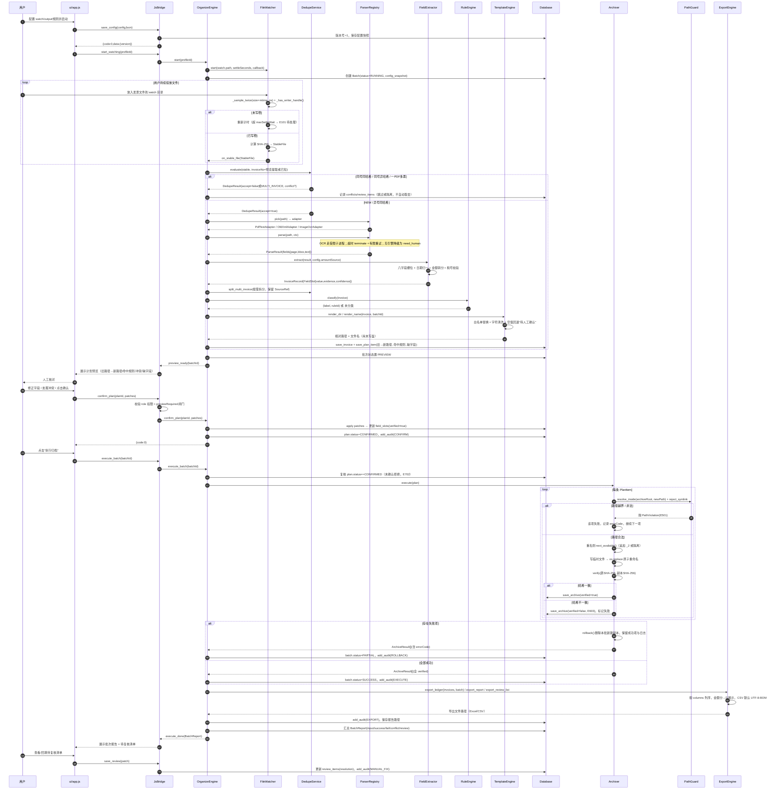
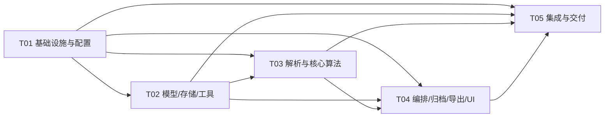

# 科研人员发票整理桌面软件 — 系统设计与任务分解（ARCHITECTURE）

| 项目 | 内容 |
|---|---|
| 文档语言 | 简体中文 |
| 项目名称 | `invoice_organizer` |
| 文档版本 | v1.0 |
| 作者 | 高见远（Gao）· 架构师 |
| 上游输入 | `docs/PRD.md` v1.0（许清楚 · 产品经理） |
| 技术基线 | Python 3.13.14 + pywebview + SQLite + pytest |
| 适用范围 | P0 全部 + P1 核心项；P2 仅保留扩展接口 |

> 设计总原则：**简单、可插拔、可回溯、路径安全、离线优先**。所有解析结果均为"整理辅助建议"，最终判断权在人工。所有字段保留证据与置信状态，看不清即"待人工确认"，绝不臆造。

---

## 目录

- [第一部分 · 系统设计](#第一部分--系统设计)
  - [1. 实现方案与框架选型](#1-实现方案与框架选型)
  - [2. 完整文件列表](#2-完整文件列表)
  - [3. 数据结构与接口（类图）](#3-数据结构与接口类图)
  - [4. 程序调用流程（时序图）](#4-程序调用流程时序图)
- [第二部分 · 任务分解](#第二部分--任务分解)
  - [5. 任务列表（有序·含依赖）](#5-任务列表有序含依赖)
  - [6. 依赖包列表（requirements.txt）](#6-依赖包列表requirementstxt)
  - [7. 共享知识](#7-共享知识跨文件约定)
  - [8. 待明确事项](#8-待明确事项)

---

# 第一部分 · 系统设计

## 1. 实现方案与框架选型

### 1.1 核心技术挑战

| # | 挑战 | 难点 | 应对策略 |
|---|---|---|---|
| C1 | 文件写入未完成时被误读 | 用户"投放"是持续写过程，读到半截文件会解析失败或数据不全 | `watcher.py` 两轮采样 `size + mtime` 一致 + 共享写句柄探测（Windows 以独占方式重试打开），写稳前不入队 |
| C2 | 多源票种解析差异大 | PDF 文本层、扫描图片、OFD 版式各不相同，且需可扩展 | `ParserAdapter` 抽象基类 + `ParserRegistry` 注册表，按扩展名/内容特征分发；新增票种不改核心 |
| C3 | OCR 不可用时不能崩 | 环境可能无 OCR 引擎，OCR 也可能超时拖垮主程序 | 文本层直读适配器为默认；OCR 走**受限子进程** + 超时 `terminate` + 有限重试；无引擎降级为"待人工确认"，绝不抛未捕获异常 |
| C4 | 字段不可臆造且要可追溯 | 每个字段需证据与置信状态，日期/金额口径要统一 | `FieldSlot` 统一携带 `value/evidence/confidence`；`dates.py`/`money.py` 集中归一；金额整数分、默认不含税 |
| C5 | 去重/冲突语义复杂 | 同号同哈希、同号异哈希、异号同哈希、一票多张、一 PDF 多票 | `dedupe.py` 以 SHA-256 为内容主键、票号为聚合主键，五类情形分支处理，冲突只提示不自动取舍 |
| C6 | 模板注入与路径越界 | 文件名来自票面，可能含 `../`、绝对路径、保留字符 | `template.py` 仅白名单占位符纯字符串替换、禁 `eval`；`paths.py` 清洗 + `resolve()` + 真实路径必须落在归档根内 |
| C7 | 归档要原子、可回滚、不覆盖 | 写盘失败不能留下半截副本，重名不能覆盖 | `archiver.py` 临时文件 + `os.replace` 原子重命名；重名追加序号/隔离；批次事务化，失败回滚本批新建副本 |
| C8 | 配置变更不能污染历史 | 历史批次必须绑定当时配置 | `profileId + version + schemaVersion` 版本化；批次记录 `profileVersion` 并按版本号存储配置快照，永不静默重算 |
| C9 | 单机环境要可验证 | 不能依赖 npm 大型构建或离线不可得的引擎 | 纯 Python 核心 + pytest 可直接验证；pywebview 壳仅加载本地 HTML，无外部网络资源 |

### 1.2 框架与库选型

| 领域 | 选型 | 版本范围 | 选型理由 |
|---|---|---|---|
| 核心逻辑 | Python 3.13 标准库 | 3.13.x（环境已装 3.13.14） | 文件/哈希/SQLite/多进程均为一等支持，免构建链 |
| PDF 解析 | `pdfplumber` | `>=0.11,<0.12` | 成熟稳定，可提取文本 + 字符级坐标（证据定位），支持 3.13 |
| 图片处理 | `Pillow` | `>=11,<12` | 图片预处理（尺寸/格式/纠偏预留），OCR 前置 |
| Excel 导出 | `openpyxl` | `>=3.1.2,<3.2` | 纯 Python、无 Excel 依赖，支持样式与列序控制 |
| 桌面壳 | `pywebview` | `>=5,<6` | 原生窗口 + JS↔Python bridge，加载本地 HTML，无 Electron 重量级构建 |
| 目录监控 | `watchdog`（含 `PollingObserver` 兜底） | `>=4,<5` | 事件驱动为主；网络盘/不支持 fsnotify 时切轮询兜底 |
| 元数据库 | `sqlite3`（标准库） | 内置 | 零部署、本地单文件、事务可靠，适配"本地优先" |
| OCR（可选） | `pytesseract` + 外部适配器占位 | `>=0.3.10,<0.4` | 可选依赖；未安装/无引擎时走降级路径，不影响启动 |
| 测试 | `pytest` | `>=8.3,<9` | 轻量、断言清晰、参数化适合黄金样本矩阵 |

**明确不选**：Electron / Tauri（构建链重、当前环境难离线验证）；React/Vite/MUI（引入 npm 大构建，违背"核心逻辑可独立 pytest 验证"）；PaddleOCR 随包分发模型（体积大、离线安装不可控，改为可替换外部适配器占位）。

### 1.3 架构模式与分层

采用**分层 + 端口适配器（六边形）**混合架构，主流程由 `OrganizeEngine` 编排，跨层只依赖抽象：

```
┌────────────────────────────────────────────────────────────┐
│  表现层  ui/  AppWindow(pywebview) · JsBridge · index.html    │  ← 只通过 bridge 调用，不碰文件/DB
├────────────────────────────────────────────────────────────┤
│  编排层  core/engine.py  OrganizeEngine（用例编排/状态机）      │
├────────────────────────────────────────────────────────────┤
│  领域层  core/  watcher dedupe fields rules template            │
│                 archiver exporter  + models/  + config/         │
├────────────────────────────────────────────────────────────┤
│  解析器层 parsers/  ParserAdapter◁── Pdf / Ofd / ImageOcr       │  ← 可插拔，注册表分发
├────────────────────────────────────────────────────────────┤
│  基础设施 storage/  Database(SQLite)   utils/  hash/paths/...   │
└────────────────────────────────────────────────────────────┘
```

**关键约束**：表现层不得直接读写文件或数据库；解析器只产出结构化文本/坐标，不做业务判断；所有写盘必须经过 `Archiver`；所有落库必须经过 `Database`。

### 1.4 关键技术决策（工程师必读）

| 决策点 | 具体方案 |
|---|---|
| 写稳检测 | 采样两轮，间隔 `settleSeconds`；`size` 与 `mtime_ns` 均无变化，且以 `CREATE_NO_WINDOW + 独占共享模式` 重试打开成功 → 判定写稳；任一轮失败重新计时，超过 `maxSettleWait` 记 `E101` 入待处理 |
| 稳定后入队 | 写稳文件生成 `StableFile(path, sha256, size, mtime_ns)` 进入处理队列；队列顺序处理，单文件异常隔离 |
| 去重主键 | 内容主键 = SHA-256；业务聚合键 = `invoiceNo`；二者组合判定五类情形（见 3.4 去重矩阵） |
| 解析器选择 | 按扩展名初选 + 内容魔数复核（`.pdf`/`%PDF`、`.ofd`/zip 内含 `OFD.xml`、图片魔数）；无匹配 → `E102` 待人工确认 |
| OCR 隔离 | `multiprocessing.Process` 子进程执行，`join(timeout)` 超时 `terminate()`；重试 `ocrRetry` 次后转 `E401` 待处理；接口 `OcrBackend` 可替换（text-layer / tesseract / umi-ocr 占位） |
| 字段置信 | `high`：文本层精确匹配且通过校验；`low`：OCR/模糊匹配；`need_human`：缺失或校验失败。低置信与待确认均进入待复核 |
| 金额口径 | 内部一律整数分 `amountCent`；默认 `totalExclTax`（合计不含税），仅 `amountSource=totalInclTax` 取价税合计；展示 `分/100` 保留两位 |
| 规则命中 | `categories` 按 `priority` 升序逐条匹配，命中首条即停（`matchAll=false` 默认）；未命中 → `未分类` 标签 |
| 模板安全 | 仅八字段 + `batchId` 白名单；占位符之外字符原样；非法字符替换为 `_`；空值回退"待人工确认"；渲染后经 `PathGuard` 二次校验 |
| 路径安全 | `PathGuard.safe_join()` → 过滤分隔符/`..`/绝对路径/Windows 保留字符 → `Path.resolve(strict=False)` → 校验 `is_relative_to(archiveRoot.resolve())` 且拒绝符号链接 → 否则 `E501` |
| 归档事务 | 每个批次收集 `PlanItem[]`，逐条写临时文件→`os.replace`→复核哈希；任一条失败，回滚本批已建副本（记录清单）+ 保留成功项与日志，批次状态 `PARTIAL` |
| 执行闸门 | `previewRequired=true` 时，未调用 `confirmPlan()` 的 `Plan` 不得进入 `Archiver`；bridge 层再次校验以防绕过 |
| 审计 | `audit_events` 表 append-only，UI 无删除入口；`role ∈ {admin,operator,reader}`，reader 只读；关键操作（确认/执行/回滚/导出/配置变更）校验授权 |
| 离线 | 除本机环回 Umi-OCR 可选外，无任何外网请求；源码不含 CDN 链接，前端资源全本地 |
| 配置快照 | 批次开始时把当前 profile 全量 JSON 快照写入 `batches.config_snapshot`；回溯读快照，不读当前配置 |

---

## 2. 完整文件列表

> 路径相对项目根 `H:/fapiao/invoice-organizer/`。共 51 个文件。

### 2.1 包入口与配置

| 相对路径 | 职责 |
|---|---|
| `invoice_organizer/__init__.py` | 包标识、`__version__`、全局常量（`SCHEMA_VERSION`、`FIELD_KEYS`、`ERROR_CODES` 引用） |
| `invoice_organizer/__main__.py` | 程序入口：`python -m invoice_organizer` 解析 CLI 参数 → 初始化 DB/日志 → 启动 pywebview 窗口；支持 `--diag` 仅跑核心自检 |
| `invoice_organizer/config/__init__.py` | 配置域导出 |
| `invoice_organizer/config/schema.py` | `ProfileConfig` 及嵌套配置 dataclass + `validate()`（枚举、目录不互相包含、模板占位符合法性、priority 唯一） |
| `invoice_organizer/config/loader.py` | 配置加载/保存/版本递增、`profileId` 多档案、快照写出、备份与恢复 |
| `invoice_organizer/config/default.json` | 默认配置模板（对应 PRD 第 6 节，版本化初值） |

### 2.2 领域模型

| 相对路径 | 职责 |
|---|---|
| `invoice_organizer/models/__init__.py` | 模型导出 |
| `invoice_organizer/models/invoice.py` | `Confidence`、`Evidence`、`FieldSlot`、`InvoiceRecord`、`ItemLine`、`SourceRef` |
| `invoice_organizer/models/plan.py` | `Plan`、`PlanItem`、`Conflict`、`PlanStatus`、人工修正 `Patch` |
| `invoice_organizer/models/batch.py` | `Batch`、`BatchStatus`、`BatchReport`、批次统计 `BatchSummary` |
| `invoice_organizer/models/audit.py` | `AuditEvent`、`Role`、`AuditAction` |

### 2.3 解析适配器层

| 相对路径 | 职责 |
|---|---|
| `invoice_organizer/parsers/__init__.py` | 解析器导出 |
| `invoice_organizer/parsers/base.py` | `ParserAdapter` 抽象基类、`ParseResult`、`RawTextField`、`OcrBackend` 协议、`ParseContext` |
| `invoice_organizer/parsers/pdf_text.py` | `PdfTextAdapter`：pdfplumber 文本层直读，产出带 `(page, x0, top, text)` 的原始字段 |
| `invoice_organizer/parsers/ofd_xml.py` | `OfdXmlAdapter`：`zipfile` + `ElementTree` 解析 OFD 包内 XML，提取文本与坐标 |
| `invoice_organizer/parsers/image_ocr.py` | `ImageOcrAdapter` + `TextLayerOcrAdapter` + `TesseractOcrAdapter` + `UmiOcrAdapter(占位)`；受限进程与降级逻辑 |
| `invoice_organizer/parsers/registry.py` | `ParserRegistry`：注册/发现适配器，按扩展名与魔数分发，未匹配返回 `None` |

### 2.4 核心领域逻辑

| 相对路径 | 职责 |
|---|---|
| `invoice_organizer/core/__init__.py` | 核心域导出 |
| `invoice_organizer/core/watcher.py` | `FileWatcher` + `StableFile`：目录监控、写稳检测、轮询兜底、入队回调 |
| `invoice_organizer/core/dedupe.py` | `DedupeService` + `DedupeResult`：SHA-256 去重、五类情形判定、同源拆分标记 |
| `invoice_organizer/core/fields.py` | `FieldExtractor`：八字段槽位提取、正则/关键词规则、校验、证据与置信标注、多行合并 |
| `invoice_organizer/core/rules.py` | `RuleEngine`：按 priority 匹配分类规则，支持 `contains`/`regex`/`equals`，首条命中停止 |
| `invoice_organizer/core/template.py` | `TemplateEngine`：白名单占位符纯字符串替换、非法字符清洗、空值回退 |
| `invoice_organizer/core/archiver.py` | `Archiver` + `PathGuard`：事务化批次写盘、原子重命名、不覆盖重名、写后哈希复核、失败回滚 |
| `invoice_organizer/core/exporter.py` | `ExportEngine`：Excel(openpyxl)/CSV(UTF-8-BOM) 台账、批次报告、待复核清单 |
| `invoice_organizer/core/engine.py` | `OrganizeEngine`：全流程用例编排（监控→去重→解析→提取→分类→计划→确认→归档→导出）与状态机 |

### 2.5 存储层

| 相对路径 | 职责 |
|---|---|
| `invoice_organizer/storage/__init__.py` | 存储域导出 |
| `invoice_organizer/storage/db.py` | `Database`：连接管理、建表、上下文事务、各实体 CRUD、批次快照读写、审计追加 |
| `invoice_organizer/storage/migrations.py` | `Migrations`：schema 版本迁移框架与 v0→v1 初始迁移 |

### 2.6 UI 层

| 相对路径 | 职责 |
|---|---|
| `invoice_organizer/ui/__init__.py` | UI 域导出 |
| `invoice_organizer/ui/app.py` | `AppWindow`：pywebview 窗口创建、加载本地 `index.html`、注入 bridge、生命周期 |
| `invoice_organizer/ui/bridge.py` | `JsBridge`：JS↔Python API，统一 `{code,data,message}` 响应，权限校验、异常转错误码 |
| `invoice_organizer/ui/index.html` | 单页应用骨架：配置、计划预览、批次历史、待复核、导出五个视图容器 |
| `invoice_organizer/ui/app.js` | 前端交互：调用 `window.pywebview.api.*`，渲染计划/批次/待复核，人工确认与回填 |
| `invoice_organizer/ui/style.css` | 纯本地样式（无外链字体/图标），浅色桌面风格 |

### 2.7 工具层

| 相对路径 | 职责 |
|---|---|
| `invoice_organizer/utils/__init__.py` | 工具域导出 |
| `invoice_organizer/utils/hashutil.py` | `HashUtil`：流式 SHA-256（大文件不整读）、文件与字节两种入口 |
| `invoice_organizer/utils/paths.py` | `PathGuard`：路径清洗、真实路径解析、归档根越界校验、符号链接拒绝、重名序号生成 |
| `invoice_organizer/utils/dates.py` | `DateUtil`：多格式（`YYYY年MM月DD日`、`YYYY/MM/DD`、`YYYYMMDD` 等）归一为 `YYYY-MM-DD` |
| `invoice_organizer/utils/money.py` | `MoneyUtil`：`元字符串→整数分`、`分→元展示`、金额口径切换、千分位与全角处理 |
| `invoice_organizer/utils/logging.py` | `configure_logging()`：文件 + 控制台双通道，按批次 tag 输出，异常堆栈落盘 |

### 2.8 测试与工程文件

| 相对路径 | 职责 |
|---|---|
| `invoice_organizer/tests/__init__.py` | 测试包标识 |
| `invoice_organizer/tests/conftest.py` | pytest fixture：临时 watch/archive 目录、内存 SQLite、样例 ParseResult、golden 样本加载器 |
| `invoice_organizer/tests/test_fields.py` | 八字段提取、置信标注、证据、日期/金额归一测试 |
| `invoice_organizer/tests/test_dedupe.py` | 五类去重情形与冲突判定测试 |
| `invoice_organizer/tests/test_rules_template.py` | 规则引擎命中顺序 + 模板占位符/路径安全测试 |
| `invoice_organizer/tests/test_archiver.py` | 原子写入、不覆盖重名、哈希复核、回滚测试（tmp_path） |
| `invoice_organizer/tests/test_exporter.py` | Excel/CSV 列序、金额元展示、编码与待复核清单测试 |
| `invoice_organizer/tests/test_paths_hash.py` | 路径越界/软链接拒绝、SHA-256 一致性测试 |
| `invoice_organizer/tests/test_engine_smoke.py` | 端到端冒烟：投放→计划→确认→归档→导出（无 OCR 降级路径） |
| `requirements.txt` | 依赖声明（见第 6 节） |
| `pytest.ini` | pytest 配置：测试发现路径、标记、严格模式 |
| `.gitignore` | 忽略 `__pycache__`、`*.pyc`、`.pytest_cache`、`*.db`、归档/隔离/导出产物、`venv/` |
| `README.md` | 由工程师编写：安装、运行、配置、测试、目录说明 |

---

## 3. 数据结构与接口（类图）

### 3.1 完整类图

```mermaid
classDiagram
    %% ===== 配置域 =====
    class ProfileConfig {
        +str profileId
        +int version
        +int schemaVersion
        +WatchConfig watch
        +OutputConfig output
        +str organizeBy
        +List~CategoryRule~ categories
        +List~str~ fields
        +str amountSource
        +str directoryTemplate
        +str filenameTemplate
        +ExportConfig export
        +ExecutionConfig execution
        +validate() List~str~
        +to_json() str
    }
    class WatchConfig {
        +str path
        +bool recursive
        +float settleSeconds
        +int maxSettleWait
    }
    class OutputConfig {
        +str archiveRoot
        +str quarantine
    }
    class CategoryRule {
        +str id
        +str label
        +int priority
        +MatchRule match
    }
    class MatchRule {
        +str field
        +str contains
        +str regex
        +str equals
    }
    class ExportConfig {
        +str template
        +List~str~ columns
        +str encoding
        +str format
    }
    class ExecutionConfig {
        +bool previewRequired
        +bool preserveSource
        +bool dedupe
        +int ocrRetry
        +int ocrTimeoutSec
    }
    ProfileConfig *-- WatchConfig
    ProfileConfig *-- OutputConfig
    ProfileConfig *-- CategoryRule
    ProfileConfig *-- ExportConfig
    ProfileConfig *-- ExecutionConfig
    ProfileConfig "1" o-- "0..*" CategoryRule
    CategoryRule *-- MatchRule
    class ProfileLoader {
        +load(profileId) ProfileConfig
        +save(config) int
        +next_version(profileId) int
        +snapshot(config) str
        +backup(dest) str
        +restore(backupPath, version) ProfileConfig
    }
    ProfileLoader ..> ProfileConfig : produces

    %% ===== 模型域 =====
    class Confidence {
        <<enumeration>>
        HIGH
        LOW
        NEED_HUMAN
    }
    class Evidence {
        +str sourceFile
        +int page
        +tuple bbox
        +str rawText
        +to_dict() dict
    }
    class FieldSlot {
        +str key
        +str value
        +Confidence confidence
        +Evidence evidence
        +bool verified
    }
    class InvoiceRecord {
        +str id
        +str invoiceNo
        +str issueDate
        +List~FieldSlot~ fields
        +List~ItemLine~ items
        +int amountCent
        +str categoryLabel
        +str categoryRuleId
        +List~SourceRef~ sources
        +str status
        +get_field(key) FieldSlot
        +merge_items(items) None
        +to_row() dict
    }
    class ItemLine {
        +str name
        +str spec
        +int quantity
        +int amountCent
    }
    class SourceRef {
        +str fileHash
        +str filePath
        +int page
        +tuple bbox
    }
    class PlanStatus {
        <<enumeration>>
        DRAFT
        CONFIRMED
        EXECUTED
        FAILED
        CANCELLED
    }
    class Patch {
        +str invoiceId
        +str fieldKey
        +str value
        +str operator
    }
    class Conflict {
        +str id
        +str type
        +str invoiceNo
        +str detail
        +str status
        +str resolution
    }
    class PlanItem {
        +str invoiceId
        +str oldPath
        +str newPath
        +str hitRuleId
        +str categoryLabel
        +List~str~ missingFields
        +Conflict conflict
        +bool confirmed
    }
    class Plan {
        +str id
        +str batchId
        +List~PlanItem~ items
        +PlanStatus status
        +int profileVersion
        +createdAt
    }
    class BatchStatus {
        <<enumeration>>
        RUNNING
        PREVIEW
        CONFIRMED
        PARTIAL
        SUCCESS
        FAILED
    }
    class BatchSummary {
        +int inputCount
        +int successCount
        +int failedCount
        +int conflictCount
        +int reviewCount
    }
    class BatchReport {
        +str batchId
        +BatchSummary summary
        +str configVersion
        +List~str~ anomalies
        +str timeRange
        +to_dict() dict
    }
    class Batch {
        +str id
        +int profileVersion
        +str configSnapshot
        +BatchStatus status
        +BatchSummary summary
        +str startedAt
        +str endedAt
        +BatchReport report
    }
    class AuditEvent {
        +str id
        +str ts
        +str actor
        +Role role
        +AuditAction action
        +str object
        +str result
        +str detail
    }
    class Role {
        <<enumeration>>
        ADMIN
        OPERATOR
        READER
    }
    class AuditAction {
        <<enumeration>>
        CONFIG_CHANGE
        CONFIRM
        EXECUTE
        EXPORT
        ROLLBACK
        MANUAL_FIX
    }
    FieldSlot *-- Evidence
    FieldSlot --> Confidence
    InvoiceRecord "1" *-- "8" FieldSlot
    InvoiceRecord "1" *-- "0..*" ItemLine
    InvoiceRecord "1" o-- "0..*" SourceRef
    Plan "1" *-- "0..*" PlanItem
    PlanItem --> Conflict
    Plan --> PlanStatus
    Batch --> BatchStatus
    Batch *-- BatchReport
    BatchReport *-- BatchSummary
    AuditEvent --> Role
    AuditEvent --> AuditAction

    %% ===== 解析器域 =====
    class ParseResult {
        +List~RawTextField~ fields
        +str sourceHash
        +str sourcePath
        +int pageCount
        +str adapterName
    }
    class RawTextField {
        +str label
        +str text
        +int page
        +tuple bbox
    }
    class ParseContext {
        +str fileHash
        +str filePath
        +int timeoutSec
        +int retry
    }
    class ParserAdapter {
        <<abstract>>
        +str name
        +can_handle(path, header) bool*
        +parse(path, ctx) ParseResult*
    }
    class PdfTextAdapter {
        +str name
        +can_handle(path, header) bool
        +parse(path, ctx) ParseResult
    }
    class OfdXmlAdapter {
        +str name
        +can_handle(path, header) bool
        +parse(path, ctx) ParseResult
    }
    class ImageOcrAdapter {
        +OcrBackend backend
        +str name
        +can_handle(path, header) bool
        +parse(path, ctx) ParseResult
        +parse_in_subprocess(path, ctx) ParseResult
    }
    class OcrBackend {
        <<interface>>
        +recognize(image) List~RawTextField~
    }
    class TextLayerOcrAdapter {
        +recognize(image) List~RawTextField~
    }
    class TesseractOcrAdapter {
        +recognize(image) List~RawTextField~
    }
    class UmiOcrAdapter {
        +str endpoint
        +recognize(image) List~RawTextField~
    }
    class ParserRegistry {
        -List~ParserAdapter~ adapters
        +register(adapter) None
        +pick(path) ParserAdapter
        +parse(path, ctx) ParseResult
    }
    ParserAdapter <|-- PdfTextAdapter
    ParserAdapter <|-- OfdXmlAdapter
    ParserAdapter <|-- ImageOcrAdapter
    OcrBackend <|.. TextLayerOcrAdapter
    OcrBackend <|.. TesseractOcrAdapter
    OcrBackend <|.. UmiOcrAdapter
    ImageOcrAdapter o-- OcrBackend
    ParserRegistry "1" o-- "0..*" ParserAdapter
    ParserAdapter ..> ParseResult : produces
    ParseResult "1" *-- "0..*" RawTextField

    %% ===== 核心服务域 =====
    class StableFile {
        +str path
        +str sha256
        +int size
        +int mtimeNs
    }
    class FileWatcher {
        +WatchConfig config
        +Queue~StableFile~ queue
        +start(callback) None
        +stop() None
        +is_settled(path) bool
        +_sample_twice(path) bool
        +_has_writer_handle(path) bool
    }
    class DedupeResult {
        +str kind
        +bool accept
        +str reason
        +Conflict conflict
    }
    class DedupeService {
        +evaluate(stable, invoiceNo) DedupeResult
        +split_multi_invoice(result) List~ParseResult~
    }
    class FieldExtractor {
        +ProfileConfig config
        +extract(result, amountSource) InvoiceRecord
        +_extract_slot(fields, key) FieldSlot
        +_validate_tax_id(v) Confidence
    }
    class RuleEngine {
        +List~CategoryRule~ rules
        +classify(invoice) tuple
    }
    class TemplateEngine {
        +ProfileConfig config
        +render_dir(invoice, batchId) str
        +render_name(invoice, batchId) str
        +_replace(tokens, invoice) str
    }
    class ArchiveResult {
        +str planItemId
        +str archivedPath
        +str sha256
        +bool verified
        +str errorCode
    }
    class PathGuard {
        +str archiveRoot
        +str quarantine
        +safe_join(root, rel) str
        +resolve_inside(root, p) str
        +next_available(path) str
        +reject_symlink(p) bool
    }
    class Archiver {
        +PathGuard guard
        +Database db
        +List~str~ createdPaths
        +execute(plan) List~ArchiveResult~
        +_write_atomic(src, dest) str
        +verify(srcHash, dest) bool
        +rollback() List~str~
    }
    class ExportEngine {
        +ExportConfig config
        +export_ledger(invoices, batch) str
        +export_report(report) str
        +export_review_list(items) str
        +_write_csv(rows, path) None
        +_write_xlsx(rows, path) None
    }
    class OrganizeEngine {
        -ProfileConfig config
        -Database db
        -FileWatcher watcher
        -ParserRegistry registry
        -DedupeService dedupe
        -FieldExtractor extractor
        -RuleEngine rules
        -TemplateEngine templates
        -Archiver archiver
        -ExportEngine exporter
        -JsBridge bridge
        +start(profileId) None
        +on_stable_file(file) str
        +build_plan(batchId) Plan
        +confirm_plan(planId, patches) bool
        +execute_batch(batchId) BatchReport
        +review_items(batchId) List
        +rollback_batch(batchId) bool
    }
    FileWatcher ..> StableFile : emits
    DedupeService ..> DedupeResult : produces
    FieldExtractor ..> InvoiceRecord : produces
    RuleEngine ..> CategoryRule : uses
    TemplateEngine ..> ProfileConfig : uses
    Archiver *-- PathGuard
    Archiver ..> ArchiveResult : produces
    OrganizeEngine "1" o-- FileWatcher
    OrganizeEngine "1" o-- ParserRegistry
    OrganizeEngine "1" o-- DedupeService
    OrganizeEngine "1" o-- FieldExtractor
    OrganizeEngine "1" o-- RuleEngine
    OrganizeEngine "1" o-- TemplateEngine
    OrganizeEngine "1" o-- Archiver
    OrganizeEngine "1" o-- ExportEngine
    OrganizeEngine "1" o-- ProfileLoader
    OrganizeEngine ..> Plan : builds
    OrganizeEngine ..> Batch : manages

    %% ===== 存储 / UI / 工具域 =====
    class Database {
        +str dbPath
        +connect() Connection
        +init_schema() None
        +save_batch(batch) None
        +save_plan(plan) None
        +save_invoice(inv) None
        +save_archive(res) None
        +add_audit(event) None
        +get_batch(id) Batch
        +get_plan(id) Plan
        +list_review(batchId) List
    }
    class Migrations {
        +current_version() int
        +migrate(conn, to) None
    }
    class JsBridge {
        +OrganizeEngine engine
        +start_watching(profileId) dict
        +get_plan(batchId) dict
        +confirm_plan(planId, patches) dict
        +execute_batch(batchId) dict
        +list_batches() dict
        +get_review(batchId) dict
        +save_review(patch) dict
        +export(batchId, format) dict
        +get_config(profileId) dict
        +save_config(configJson) dict
        +_wrap(fn) dict
    }
    class AppWindow {
        +start() None
        +_inject_api() None
        +on_closed() None
    }
    class HashUtil {
        <<static>>
        +file_sha256(path) str
        +bytes_sha256(data) str
    }
    class DateUtil {
        <<static>>
        +normalize(text) str
    }
    class MoneyUtil {
        <<static>>
        +yuan_to_cent(text, source) int
        +cent_to_yuan(cent) str
    }
    Database ..> Migrations : uses
    Database ..> AuditEvent : stores
    Archiver --> Database : persists
    OrganizeEngine --> Database : persists
    JsBridge --> OrganizeEngine : delegates
    AppWindow *-- JsBridge
    FileWatcher ..> HashUtil : uses
    FieldExtractor ..> DateUtil
    FieldExtractor ..> MoneyUtil
    Archiver ..> HashUtil : verifies
```



### 3.2 关键接口签名（工程师落地清单）

| 模块 | 方法 | 签名要点 |
|---|---|---|
| `ParserAdapter` | `parse` | `(path: str, ctx: ParseContext) -> ParseResult`；不得抛未捕获异常，失败返回空字段 + 告警 |
| `FieldExtractor` | `extract` | `(result: ParseResult, amountSource: str) -> InvoiceRecord`；值一律经 `confidence` 标注 |
| `DedupeService` | `evaluate` | `(stable: StableFile, invoiceNo: str) -> DedupeResult`；`kind ∈ {NEW,DUP_SAME_HASH,CONFLICT_SAME_NO,SAME_HASH_MULTI_NO,MULTI_INVOICE}` |
| `RuleEngine` | `classify` | `(invoice: InvoiceRecord) -> (label: str, ruleId: str|None)` |
| `TemplateEngine` | `render_dir/render_name` | `(invoice: InvoiceRecord, batchId: str) -> str`，返回相对路径/文件名，不含非法字符 |
| `PathGuard` | `resolve_inside` | `(root: str, p: str) -> str`，越界或软链接抛 `PathViolation` |
| `Archiver` | `execute` | `(plan: Plan) -> List[ArchiveResult]`；内部维护 `createdPaths` 供回滚 |
| `JsBridge` | 全部 | 统一返回 `dict{code,data,message}`；内部 `_wrap` 捕获异常映射错误码 |

### 3.3 去重判定矩阵

| 情形 | `DedupeResult.kind` | `accept` | 处理 |
|---|---|---|---|
| 同票号 + 同 SHA-256 | `DUP_SAME_HASH` | `false` | 跳过或移入隔离区（`output.quarantine`） |
| 同票号 + 不同 SHA-256 | `CONFLICT_SAME_NO` | `false` | 生成 `Conflict`，进入冲突复核，不自动取舍 |
| 不同票号 + 同 SHA-256 | `SAME_HASH_MULTI_NO` | `true` | 保留一条物理记录，关联多个票号 |
| 一 PDF 多票 | `MULTI_INVOICE` | `true` | 拆为多条 `InvoiceRecord`，保留 `SourceRef(page,bbox)` 同源标记 |
| 新文件 | `NEW` | `true` | 正常入队解析 |

### 3.4 数据库表结构（逻辑模型）

| 表 | 主键 | 关键字段 | 说明 |
|---|---|---|---|
| `profiles` | `profile_id` | `version, schema_version, config_json, is_active` | 配置多版本，历史不删 |
| `files` | `id` | `sha256(unique), path, size, mtime_ns, first_seen_at, status` | 内容哈希去重依据 |
| `invoices` | `id` | `batch_id, invoice_no, issue_date, amount_cent, category_label, status` | 一票一记录 |
| `field_slots` | `id` | `invoice_id, field_key, value, confidence, evidence_json, verified` | 八字段证据与置信 |
| `batches` | `id` | `profile_version, config_snapshot, status, summary_json, started_at, ended_at` | 批次与配置快照 |
| `plans` | `id` | `batch_id, status, created_at` | 计划主表 |
| `plan_items` | `id` | `plan_id, invoice_id, old_path, new_path, hit_rule_id, missing_fields_json, confirmed` | 旧→新路径候选 |
| `archives` | `id` | `plan_item_id, source_sha256, archived_path, archived_sha256, verified` | 归档副本与复核 |
| `conflicts` | `id` | `batch_id, type, invoice_no, detail_json, status, resolution` | 冲突复核 |
| `review_items` | `id` | `batch_id, invoice_id, field_key, reason, status, resolution` | 待人工确认/低置信 |
| `audit_events` | `id` | `ts, actor, role, action, object, result, detail` | append-only 审计 |

---

## 4. 程序调用流程（时序图）

### 4.1 主流程（覆盖：投放文件→写稳→去重→解析→字段校验→规则分类→计划预览→人工确认→副本归档→哈希复核→导出）



### 4.2 关键子流程说明

| 子流程 | 关键分支 |
|---|---|
| 写稳检测 | 两轮 `size+mtime_ns` 一致 ∧ 无共享写句柄 → 写稳；否则重试；超 `maxSettleWait` → `E101` |
| OCR 降级 | `pick()` 无适配器 → `E102` 待确认；无 OCR 引擎 → `TextLayerOcrAdapter` 无文本 → 字段 `need_human`；超时 → `ocrRetry` 次后 `E401` 待处理 |
| 哈希复核 | 写后重算副本 SHA-256，与源文件比对；不一致 → `E603` 并回滚该项/批次 |
| 事务回滚 | `Archiver.createdPaths` 记录本批新建副本；失败时逐一删除（仅删本次副本，**原件永不删除**） |

---

# 第二部分 · 任务分解

## 5. 任务列表（有序·含依赖）

> 遵循"最多 5 个任务、首任务为项目基础设施、每任务≥3 个相关文件、按功能模块分组"的原则。依赖尽量收敛到 T01/T02，避免长线性链。工程师可并行 T02/T03/T04（在 T01 完成后）。

### T01 — 项目基础设施与配置骨架

| 项 | 内容 |
|---|---|
| **任务 ID** | T01 |
| **优先级** | P0 |
| **依赖** | 无 |
| **目标** | 建立可运行的包骨架、依赖声明、测试配置、默认配置与配置模型，为后续所有任务提供基座 |
| **源文件** | `requirements.txt`、`pytest.ini`、`.gitignore`、`invoice_organizer/__init__.py`、`invoice_organizer/__main__.py`、`invoice_organizer/config/__init__.py`、`invoice_organizer/config/schema.py`、`invoice_organizer/config/loader.py`、`invoice_organizer/config/default.json` |
| **要点** | ① 定义 `SCHEMA_VERSION`、八字段 `FIELD_KEYS`、错误码常量；② `ProfileConfig.validate()` 实现目录不互相包含、枚举合法、占位符合法、priority 唯一；③ `loader` 支持多档案 + 版本递增 + 快照；④ `__main__.py` 支持 `--diag` 自检；⑤ 安装依赖后 `python -m invoice_organizer --diag` 可跑通 |
| **验收** | 依赖可安装；`--diag` 输出版本号与配置校验结果；`pytest` 可收集（此时 0 用例） |

### T02 — 数据模型、存储层与工具层

| 项 | 内容 |
|---|---|
| **任务 ID** | T02 |
| **优先级** | P0 |
| **依赖** | T01 |
| **目标** | 落地全部领域模型、SQLite 存储与通用工具，形成"可持久化、可校验"的领域底座 |
| **源文件** | `invoice_organizer/models/{__init__,invoice,plan,batch,audit}.py`、`invoice_organizer/storage/{__init__,db,migrations}.py`、`invoice_organizer/utils/{__init__,hashutil,paths,dates,money,logging}.py`、`invoice_organizer/tests/conftest.py` |
| **要点** | ① 模型全部 dataclass/Enum，字段与 3.1 类图一致；② `Database` 建 11 张表 + 事务上下文；③ `PathGuard.resolve_inside()` 严格越界/软链接校验；④ `HashUtil` 流式 SHA-256；⑤ `DateUtil`/`MoneyUtil` 归一；⑥ `conftest` 提供 tmp 目录与内存 DB fixture |
| **验收** | `pytest` 可执行 `test_paths_hash.py`；模型可 JSON 序列化；DB 建表无错 |

### T03 — 解析适配器与核心领域算法

| 项 | 内容 |
|---|---|
| **任务 ID** | T03 |
| **优先级** | P0 |
| **依赖** | T01, T02 |
| **目标** | 实现可插拔解析层 + 去重/字段/规则/模板四大算法，达成"从原始文件到可分类的发票记录" |
| **源文件** | `invoice_organizer/parsers/{__init__,base,pdf_text,ofd_xml,image_ocr,registry}.py`、`invoice_organizer/core/{__init__,dedupe,fields,rules,template}.py`、`invoice_organizer/tests/{test_fields,test_dedupe,test_rules_template}.py` |
| **要点** | ① `ParserAdapter` 抽象 + 注册表魔数分发；② OCR 受限进程 + 有限重试 + 无引擎降级；③ 八字段证据/置信、多行合并、日期金额口径；④ 去重五类情形；⑤ 规则首条命中停止；⑥ 模板白名单替换 + 空值回退 + 路径安全交由 `PathGuard` |
| **验收** | 三适配器单测通过；黄金 ParseResult 提取字段带证据/置信；去重写矩阵、模板注入用例全绿 |

### T04 — 编排层、归档执行、导出与 UI

| 项 | 内容 |
|---|---|
| **任务 ID** | T04 |
| **优先级** | P0 |
| **依赖** | T01, T02, T03 |
| **目标** | 打通全流程：编排引擎 + 写稳监控 + 事务化归档 + 导出 + pywebview 前端，形成可操作的桌面应用 |
| **源文件** | `invoice_organizer/core/{watcher,archiver,exporter,engine}.py`、`invoice_organizer/ui/{__init__,app,bridge,index.html,app.js,style.css}.py/html/js/css`、`invoice_organizer/tests/{test_archiver,test_exporter,test_engine_smoke}.py` |
| **要点** | ① `watcher` 写稳检测 + 轮询兜底；② `Archiver` 原子写、不覆盖、哈希复核、失败回滚、原件只读；③ `ExportEngine` 列序/元展示/UTF-8-BOM/待复核清单；④ `OrganizeEngine` 状态机 + 确认闸门；⑤ `JsBridge` 统一响应 + 权限；⑥ 前端五视图，无外链资源 |
| **验收** | `test_archiver` 回滚用例通过；`test_engine_smoke` 端到端跑通（投放→计划→确认→归档→导出）；pywebview 窗口可启动并展示计划预览 |

### T05 — 集成、测试补全与交付文档

| 项 | 内容 |
|---|---|
| **任务 ID** | T05 |
| **优先级** | P1 |
| **依赖** | T01, T02, T03, T04 |
| **目标** | 全量测试回归、异常矩阵覆盖、README 与最终联调，达成"可运行项目 + 基础验证"交付 |
| **源文件** | `invoice_organizer/tests/__init__.py`、`invoice_organizer/tests/test_*.py`（补全与回归）、`README.md`、`docs/ARCHITECTURE.md`（如需同步）、全项目联调 |
| **要点** | ① 跑全量 `pytest`，修复集成缺陷；② 覆盖异常矩阵核心项（遮挡/同号异件/重名/路径注入/磁盘满模拟/OCR超时）；③ README 写安装/运行/配置/测试/目录说明；④ 校验离线（无外网请求）、原件只读、审计不可删 |
| **验收** | `pytest -q` 全绿；`python -m invoice_organizer` 可启动；README 完整；无外链资源残留 |

### 5.1 任务依赖图



---

## 6. 依赖包列表（requirements.txt）

```txt
# ---- 核心解析 ----
pdfplumber>=0.11.0,<0.12.0        # PDF 文本层 + 字符坐标（证据定位）
Pillow>=11.0.0,<12.0.0            # 图片预处理，OCR 前置

# ---- 导出 ----
openpyxl>=3.1.2,<3.2.0            # Excel 台账导出（纯 Python）

# ---- 桌面壳 ----
pywebview>=5.0,<6.0               # 原生窗口 + JS↔Python bridge，加载本地 HTML

# ---- 目录监控 ----
watchdog>=4.0.0,<5.0.0            # 文件事件监控；PollingObserver 作轮询兜底

# ---- 测试 ----
pytest>=8.3.0,<9.0.0              # 单元 / 集成 / 冒烟测试

# ---- 可选 OCR 适配器（未安装或无需时不影响启动，降级为待人工确认）----
pytesseract>=0.3.10,<0.4.0        # Tesseract 适配器；需本机安装 tesseract 可执行文件
# Umi-OCR 通过本机 HTTP 调用，适配器占位，无需额外 Python 依赖
```

> 说明：Python 3.13 标准库已覆盖 `sqlite3 / hashlib / multiprocessing / zipfile / xml.etree / pathlib / os.replace` 等核心能力，无需额外依赖。`pdfminer.six` 由 `pdfplumber` 传递依赖，不单独声明。

---

## 7. 共享知识（跨文件约定）

> 工程师实现所有文件时**必须遵守**以下约定，避免跨模块口径不一致。

### 7.1 命名规范

| 对象 | 规范 | 示例 |
|---|---|---|
| 文件/目录 | `snake_case` | `image_ocr.py`、`field_slots` |
| 类 | `PascalCase` | `InvoiceRecord`、`TemplateEngine` |
| 函数/方法/变量 | `snake_case` | `render_name()`、`amount_cent` |
| 常量 | `UPPER_SNAKE_CASE` | `SCHEMA_VERSION`、`FIELD_KEYS` |
| Mermaid/文档 | 简体中文说明 | — |

### 7.2 字段键与置信状态（唯一权威）

| 项 | 取值 |
|---|---|
| 八字段槽位键（顺序固定） | `invoiceNo`, `issueDate`, `buyerName`, `buyerTaxId`, `sellerName`, `sellerTaxId`, `itemName`, `amountCent` |
| 安全元变量（模板可用） | `batchId` |
| 置信状态 | `high`（文本层精确+校验通过）、`low`（OCR/模糊）、`need_human`（缺失/校验失败） |
| 复核范围 | `low` 与 `need_human` 都进入待复核清单 |
| 证据字段 | `Evidence{sourceFile, page, bbox, rawText}`；`page` 从 1 开始，`bbox=(x0,top,x1,bottom)` |

### 7.3 金额与日期

| 项 | 约定 |
|---|---|
| 金额内部单位 | 整数分（`amountCent`，`int`），禁止浮点存储 |
| 金额展示 | `cent_to_yuan()`：`分/100` 保留两位，导出用元 |
| 金额口径 | 默认 `totalExclTax`（合计不含税）；`amountSource=totalInclTax` 才取价税合计 |
| 用户输入金额 | 同样按分存储（元字符串经 `MoneyUtil` 转换） |
| 日期格式 | 统一 `YYYY-MM-DD`；`DateUtil.normalize()` 处理多格式；无法归一 → `need_human` |
| 税号校验 | 18 位统一社会信用代码字符集 `0-9A-HJ-NP-RTUWXY`；异常 → `need_human` |

### 7.4 统一响应格式与错误码

**所有 `JsBridge` 方法返回** `dict{code:int, data:Any, message:str}`，`code=0` 表示成功。

| 错误码 | 含义 | 处理 |
|---|---|---|
| `E000` | 成功 | — |
| `E101` | 写稳检测超时 | 入待处理，可重试 |
| `E102` | 无匹配解析器 / 不支持类型 | 待人工确认 |
| `E201` | 同号同哈希重复 | 跳过或隔离 |
| `E202` | 同号异哈希冲突 | 冲突复核 |
| `E203` | 目标重名 | 追加序号或隔离（自动处理，非错误） |
| `E301` | 字段缺失 / 低置信 | 待人工确认 |
| `E302` | 日期无法归一 | 待人工确认 |
| `E303` | 金额解析失败 | 待人工确认 |
| `E401` | OCR 超时（重试耗尽） | 待处理 |
| `E402` | 无可用 OCR 引擎 | 降级，字段标 `need_human` |
| `E501` | 路径越界 / 软链接 / 非法字符 | 拒绝写入 |
| `E502` | 输入与输出目录互相包含 | 配置保存时拒绝 |
| `E601` | 磁盘满 / 目录无权限 | 批次暂停，保留成功项 |
| `E602` | 原子写入失败（已回滚） | 记录失败项 |
| `E603` | 写后哈希复核不一致 | 标记失败并回滚 |
| `E701` | 配置校验失败 / schema 不兼容 | 拒绝保存 |
| `E702` | 计划未确认禁止执行 | 拒绝执行 |
| `E801` | 审计写入失败 | 中止关键操作并告警 |

### 7.5 配置与批次约定

| 项 | 约定 |
|---|---|
| 配置版本 | `profileId` 定位档案；`version` 每次变更 +1；`schemaVersion` 表结构版本（当前 `SCHEMA_VERSION=1`） |
| 配置快照 | 批次开始时全量 JSON 快照写入 `batches.config_snapshot`；回溯只读快照，永不静默重算 |
| 批次 ID | `B` + `YYYYMMDD` + `-` + `HHMMSS` + `-` + 4 位大写随机，例 `B20241124-084100-3F2A` |
| `amountSource` 枚举 | `totalExclTax`（默认）/`totalInclTax` |
| 目录关系 | `watch.path` 与 `output.archiveRoot`/`output.quarantine` 不得互相包含（含子目录），保存时校验 `E502` |
| 规则匹配 | `priority` 升序；`match` 支持 `contains`/`regex`/`equals`；命中首条停止；未命中标签固定为 `未分类` |
| 模板 | 仅八字段 + `batchId` 白名单；纯字符串替换，禁 `eval`/脚本；非法字符→`_`；空值→`待人工确认` |

### 7.6 路径与文件安全

| 项 | 约定 |
|---|---|
| 归档根 | `PathGuard.resolve_inside()` 后必须是 `archiveRoot.resolve()` 的子路径，否则 `E501` |
| 符号链接 | 源与目标均拒绝符号链接写入 |
| 重名 | `next_available()` 追加 `_2`/`_3`，超出策略则入隔离区，绝不覆盖 |
| 原件 | `preserveSource=true` 恒定；原件只读，任何路径不得删除/修改原件 |
| 原子写 | 写临时文件（同目录）→ `os.replace`；副本写后 SHA-256 复核 |
| 回滚范围 | 仅删除本批 `Archiver.createdPaths` 中新建副本；成功项与日志保留 |

### 7.7 审计与权限

| 项 | 约定 |
|---|---|
| 角色 | `ADMIN`（全部）/ `OPERATOR`（确认/执行/导出）/ `READER`（只读） |
| 审计动作 | `CONFIG_CHANGE`/`CONFIRM`/`EXECUTE`/`EXPORT`/`ROLLBACK`/`MANUAL_FIX` |
| 审计写入 | append-only，UI 无删除入口；记录 `ts/actor/role/action/object/result/detail` |
| 单机边界 | 本地角色不等同网络隔离；软件默认离线，无外网请求 |

### 7.8 日志

| 项 | 约定 |
|---|---|
| 通道 | 文件 + 控制台双通道；异常堆栈落盘 |
| 批次标记 | 每条日志带 `batchId`，便于按批次检索 |
| 位置 | 默认写到用户数据目录下的 `logs/invoice_organizer.log`（由 `configure_logging()` 统一管理） |

---

## 8. 待明确事项

> 以下事项不影响本次设计与开发启动（均已设合理默认），但需团队/用户后续确认以细化验收。

| # | 事项 | 影响 | 本设计采用的默认（可覆盖） |
|---|---|---|---|
| A1 | OCR 引擎最终选型与随包模型 | 识别能力、离线能力、包体 | 默认"文本层直读"，OCR 走可替换适配器（tesseract/umi-ocr 占位）；无引擎降级待人工确认，不随包分发大模型 |
| A2 | OCR 超时阈值与重试次数量化值 | 验收判据具体数值 | 默认 `ocrTimeoutSec=20`、`ocrRetry=2`，写入 `execution` 配置可改；PRD Q4 待团队确认 |
| A3 | 目标 Windows 版本 / 架构 | 兼容性与打包 | 默认 Windows 10/11 x64；`pywebview` 依赖系统 WebView2（需在目标环境确认） |
| A4 | OFD 票种覆盖范围与样本 | `OfdXmlAdapter` 字段映射深度 | 默认支持常见 OFD 版式文本抽取；复杂版式字段标 `need_human`；样本需脱敏（PRD Q3） |
| A5 | 黄金样本集来源与脱敏方式 | 验收比对基准 | 由团队提供脱敏样本，工程师按 `conftest` golden loader 加载；本设计不臆造准确率数值 |
| A6 | 权限认证方式（本地口令强度） | 关键操作授权实现 | 默认本地简单角色切换（演示级），非网络级隔离；如需口令由团队定义 |
| A7 | 备份/恢复粒度（P1-05） | 恢复到指定批次/版本 | 默认整库 + 配置备份，恢复按 `version` 回滚配置、按 `batchId` 读取快照；细粒度差异恢复留待确认 |
| A8 | 导出列序默认值 | 台账默认列 | 默认八字段 + 分类标签 + 归档路径 + 批次 ID + 配置版本 + 字段状态；列序可在 `export.columns` 覆盖 |

> 说明：以上默认均写入配置或常量，团队确认后仅需改配置/常量，不需改架构。PRD 中 Q1（桌面容器）、Q5（金额口径）、Q6/Q7 已由技术选型约束或本设计默认消解。
